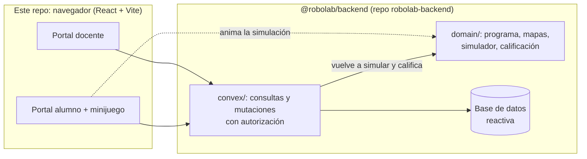

# RoboLab

Retos de programación con un robot, para Inicial y Primaria, en dos modos:

- **Explorar retos (sin cuenta).** Cualquiera entra, elige un tópico y un
  nivel y resuelve retos de pensamiento computacional: armar la secuencia,
  esquivar obstáculos, predecir dónde termina el robot, corregir un programa
  con error, pasar por paradas y resolver con pocos bloques. Robi, la guía,
  reacciona a cada intento y da hasta 3 pistas. El avance se guarda en el
  dispositivo.
- **Clases.** Cada clase tiene un código (como `TEC-482`): el alumno se une con
  ese código y un apodo, sin cuenta. El docente crea retos, los asigna a la
  clase y desde la pestaña **Retos** controla todo: quién los logró, asignarlos
  a otra clase, cerrarlos y reabrirlos. En **Progreso** ve cómo aprende la clase
  reto por reto.

Como extra, el mismo programa se puede enviar a un robot físico (ESP32) por
wifi con el botón "Enviar al robot". El relé, el protocolo y el firmware están
en el repo del backend:
[robolab-backend/docs/robot-wifi.md](https://github.com/orinqq/robolab-backend/blob/main/docs/robot-wifi.md).

Hecho para el track **Educación Escolar** de Hack the Andes 2026.

Este repo es la **web** (Vite + React 19 + TypeScript). El backend en Convex y
el dominio compartido (reglas del juego, calificación, códigos) viven en
[orinqq/robolab-backend](https://github.com/orinqq/robolab-backend) y llegan
aquí como el paquete npm `@robolab/backend`.

## Qué hace

**Explorar retos**

- Portada con los cinco tópicos STEAM, cada uno con su avance "n/m ✓": Ciencia
  y Tecnología tienen 12 retos, Ingeniería 10, Artes 9 y Matemáticas 11. En
  Inicial son retos de bloques; en Primaria, misiones con energía.
- El tablero de bloques se ambienta según el tópico: el jardín (Tecnología), el
  laboratorio (Ciencia), el taller (Ingeniería), la galería (Artes) y los números
  (Matemáticas).
- Cada reto tiene una ficha (historia, tiempo, habilidad, vista previa del
  tablero), el juego con Robi y sus pistas, y "¡Reto logrado!" con intentos,
  pistas y tiempo.
- "Mi avance" muestra lo resuelto por tópico en ese dispositivo.
- Cada partida resuelta se registra de forma anónima (un identificador al azar
  del dispositivo, sin nombres) para medir el uso real; el servidor vuelve a
  revisar si el reto se resolvió.

**Docente**

- Se registra e inicia sesión con correo y contraseña. La contraseña pide
  minúscula, mayúscula, número, símbolo y 8 caracteres, y el formulario marca
  cada regla mientras se escribe.
- Si la olvida, recibe un código de 6 dígitos en su correo registrado (vence
  en 15 minutos).
- Crea clases (nivel, grado y sección): cada una recibe un código para copiar y
  compartir; los alumnos se unen solos con su apodo. Puede eliminar una clase
  con todo lo que cuelga de ella.
- Crea retos: tópico y nivel, un juego ya hecho (bloques en Inicial, misiones en
  Primaria) y quién lo verá (público, solo su clase o borrador). Obtiene un
  enlace para compartir y lo asigna a una clase.
- En **Retos** ve todos sus retos (de todas sus clases y los que aún no asignó)
  con filtros por clase, tópico y estado (activos y cerrados). En el detalle de
  un reto ve el porcentaje que lo logró y la tabla por apodo (intentos, pistas y
  tiempo) con lo que se observó; puede asignarlo a otra clase y cerrarlo o
  reabrirlo (un reto cerrado deja de verse para los alumnos y conserva sus
  resultados). Solo se muestra lo observable; no se diagnostica.
- En **Progreso** ve, por clase, un punto por reto asignado con cuatro medidas
  (intentos, pistas, tiempo y cuántos lo lograron), una tabla por alumno y
  «Para mirar de cerca» (retos seguidos sin lograr y retos sin empezar).

**Alumno**

- Se une a su clase con el código de la clase y un apodo, sin cuenta ni
  contraseña, y ve los retos de su clase. En "Mi avance"
  aparece su apodo y su clase.
- Arma un programa tocando bloques (avanzar, retroceder y girar; en Primaria
  también repetir) y lo ejecuta. Si el robot se sale del camino, se le
  dice en qué paso y se marca ese bloque.
- Al terminar un reto ve cuántas veces ejecutó el robot, las pistas que usó y
  el tiempo. Puede repetirlo.

## Arquitectura

### Programar con gestos en Inicial

En los retos abiertos de Inicial que permiten editar el programa, arriba a la
derecha de **Tu programa** están **Gestos** (elegido al entrar) y **Botones**. Con
Gestos, la bandeja **Piezas** muestra solo manos (dedo arriba, abajo, izquierda,
derecha y el pulgar para ejecutar) y la cámara se enciende sola debajo del
jardín; permite el acceso y muestra una sola mano. Con Botones, las piezas son
flechas y la cámara se apaga. Si la cámara no se puede encender, vuelve a
Botones y lo avisa. Los dos modos arman el mismo programa. La papelera y
**Ejecutar** van dentro del cuadro del programa, y Robi (con las pistas) junto
al reto:

| Gesto | Acción |
| --- | --- |
| ☝️ Índice apuntando arriba | Avanzar |
| 👇 Índice apuntando abajo | Retroceder |
| 👈 Índice apuntando a la izquierda | Girar a la izquierda |
| 👉 Índice apuntando a la derecha | Girar a la derecha |
| 👍 Pulgar arriba | Confirmar y ejecutar el programa visible |

Mantén el gesto hasta llenar la barra (0,8 segundos para bloques; 1,2 para
confirmar); la pieza del gesto que la cámara ve se resalta en la bandeja. Retira la mano durante al menos 0,4 segundos entre gestos, también
para repetir el mismo bloque. Puedes quitar un bloque tocándolo, borrar el
programa o cambiar a Botones sin perder la secuencia. Un programa vacío no
se ejecuta y la entrada queda en pausa mientras Robi se mueve.

Usa el índice extendido con los otros dedos recogidos. Las cuatro direcciones
se calculan con los puntos de la mano de MediaPipe y coinciden con la vista en
espejo; no dependen de los gestos «Victoria» o «Te quiero». Una dirección
diagonal o un dedo apuntando hacia la cámara no agrega bloques. Las órdenes
siguen siendo relativas al robot: arriba agrega Avanzar, abajo Retroceder y
los lados agregan un giro, cualquiera sea la orientación actual de Robi.

Retroceder en Inicial requiere el cambio compartido del
[PR del backend #6](https://github.com/orinqq/robolab-backend/pull/6).
El paquete queda fijado al commit de ese PR para probarlo. Antes de usarlo en
producción, hay que fusionar y desplegar ese cambio del backend.

La cámara se activa solo al pedirla; se apaga al salir del reto, al apagarla,
al ocultar la pestaña o si falla la captura. No se pide micrófono, no se
graba vídeo y las imágenes se procesan en el equipo con MediaPipe en un worker.
El modelo y WebAssembly se descargan de Google y jsDelivr al activar la cámara;
se necesita internet para esa carga. Las versiones están fijadas. HTTPS (o
localhost) es obligatorio. Si se deniega el permiso o falla el modelo, sigue
disponible tocar las piezas.

**Para probar:** abre `/reto/inicial-paseo`, empieza el reto y arma una secuencia
con la cámara. Revisa los bloques y confirma con 👍 o con el botón **Ejecutar**.
Prueba también `/reto/inicial-gira` para los giros. Los retos de predicción,
Primaria mantienen su entrada habitual.

El enlace publicado `/r/cie-inicial/` pertenece a otra versión de la web:
su reto «El tubo de ensayo» no está en el catálogo `@robolab/backend` de este
repositorio. Esta implementación usa los retos actuales de Inicial; no crea
mapas ni reglas de juego en la web.

### Flujo compartido



- **Dominio compartido por npm.** Las reglas del juego y de la calificación se
  importan de `@robolab/backend/domain/...`: el navegador las usa para animar al
  robot y el servidor para validar. Es el mismo código, instalado desde git.
- **Funciones tipadas.** `@robolab/backend/convex/_generated/api` y
  `.../dataModel` dan los tipos de las funciones y de los `Id<"tabla">`;
  TypeScript revisa que cada llamada mande los argumentos correctos.
- **El servidor manda.** La web muestra; el backend vuelve a simular, cuenta las
  ejecuciones y califica con su reloj. La respuesta correcta nunca llega al alumno.

### Carpetas

```
src/features/      pantallas: explore/, teacher/, student/, game/, robot/, landing/
src/shared/        estilos, errores, conexión y componentes comunes
src/app/           rutas
public/            gráficos del robot, bloques y estrella
```

## Cómo correrlo

Requisitos: **Node 22.12 o superior** (hay un `.nvmrc`) y git.

**1. Backend primero.** Clonar [robolab-backend](https://github.com/orinqq/robolab-backend)
y seguir su README (`npm ci`, `npx convex dev`, `npm run setup`). Al terminar,
su `.env.local` tiene un `CONVEX_URL=https://....convex.cloud` (o la dirección
del backend local).

**2. Web.**

```bash
git clone https://github.com/orinqq/robolab-web.git
cd robolab-web
npm ci
```

Crear `.env.local` con la dirección del backend (ver `.env.example`):

```
VITE_CONVEX_URL=<el CONVEX_URL del .env.local del backend>
```

```bash
npm run dev
```

Abre http://localhost:5173. Sin cuenta se juegan los retos; en "Soy docente"
se crea una cuenta en ese backend.

### Actualizar el backend

`npm ci` instala `@robolab/backend` desde GitHub por https, en el **commit exacto**
que fija `package-lock.json`. Cuando el backend cambie en `main`, traer la
versión nueva y commitear el lockfile:

```bash
npm install git+https://github.com/orinqq/robolab-backend.git#main
git add package.json package-lock.json
git commit -m "Backend al día"
```

Si TypeScript marca una función o un tipo que ya no existe, el backend cambió
su contrato: ajustar la web en ese mismo cambio.

## Robot por USB (opción inicial)

La hoja **Robot → USB** usa el cable USB de datos del ESP32 con Web Serial en
Chrome de escritorio, por HTTPS o localhost. No requiere emparejar Bluetooth ni
activar opciones experimentales. El cable debe permanecer conectado durante el
recorrido; el robot conserva su alimentación habitual para los motores.

1. Cargar el sketch completo `firmware/robi/robi.ino` del backend. El transporte
   predeterminado es USB a **115200 baudios**; motores, ojos, luces, sonidos y
   calibración se conservan.
2. Conectar el cable y cerrar el monitor serie de Arduino y otras aplicaciones
   que usen ese puerto.
3. En el reto, tocar **Robot → USB → Elegir puerto USB** y elegir **USB Serial**,
   **CH340** o el puerto de la placa.
4. Esperar **Robot conectado**: la web lo muestra cuando responde el firmware.

Abrir USB puede reiniciar la placa. Durante esa espera la web repite únicamente
el saludo, con un límite de ocho segundos. Antes de abrir la sesión invalida
cualquier trama incompleta y envía STOP. Al desconectar, no repite programas;
el firmware conserva la parada de seguridad al perder los latidos.

**Ejecutar** envía la secuencia una vez. **Parar robot** sigue disponible aunque
el tablero ya haya terminado. Si falla la apertura, revisar el cable, los
permisos del puerto y que ninguna otra aplicación lo tenga abierto.

Referencia: [Web Serial en Chrome](https://developer.chrome.com/docs/capabilities/serial).

## Robot por Bluetooth BLE (opcional)

La hoja **Robot → Bluetooth** conecta directamente con el ESP32 usando
Web Bluetooth (BLE). Convex mantiene las clases y los resultados; el robot no necesita
wifi para recibir los movimientos. El modo **Wifi** conserva la conexión por código.

1. Habilitar el modo BLE del firmware (`ROBOLAB_USAR_BLE=1`) y cargar el sketch
   completo `firmware/robi/robi.ino` del backend. Incluye los
   motores, ojos, luces y sonidos en un solo archivo; no necesita copiar `.h`.
   El firmware anterior de Bluetooth Classic no ofrece el servicio BLE requerido.
2. Activar Bluetooth en el equipo. El robot se elige desde la web; no hay que
   emparejarlo en los ajustes del sistema.
3. Abrir la web por HTTPS o localhost en **Chrome** actualizado. En Ubuntu/Linux,
   habilitar una vez **Experimental Web Platform features** en
   `chrome://flags/#enable-experimental-web-platform-features` y reiniciar Chrome.
4. En el reto, tocar **Robot → Elegir robot** y seleccionar **RoboLab**.
   El chip solo cambia a conectado después de que responde el firmware.

**Ejecutar** envía al robot vinculado en los retos de bloques. La hoja permite
enviar manualmente y **Parar robot** queda disponible durante la ejecución,
incluso si el tablero ya muestra el resultado. Salir del reto cierra el enlace.
Los latidos permiten al firmware detener motores ante una conexión perdida;
mantener la pestaña activa durante el recorrido.

El montaje actual de dos MOSFET solo admite avance y giros **en arco**. Si el
programa contiene retroceso, la web lo avisa y no lo envía. Los tiempos necesitan
calibración física; el recorrido dibujado no verifica el movimiento real.

El contrato, pines y pruebas de aceptación están en
[robot-bluetooth.md del backend](https://github.com/orinqq/robolab-backend/blob/main/docs/robot-bluetooth.md).
El lockfile fija el commit del backend oficial por `git+https`.
La API requiere Web Bluetooth; Chrome es el navegador priorizado. Si no está
disponible, se muestra cómo habilitarlo y la alternativa Wifi. Firefox, Zen y
Safari no ofrecen esta conexión BLE de forma nativa.

Al volver a conectar, la web espera que termine de cerrarse la conexión anterior,
también al cambiar de reto. Usa el robot en una sola pestaña o navegador a la vez.
Si falla, **Detalles de conexión** conserva la etapa y el error del navegador.
Comprueba que RoboLab esté encendido y cerca, desconéctalo de otros equipos y
vuelve a elegirlo. La web obtiene servicios y características nuevos en cada
conexión y nunca reenvía automáticamente un programa tras un corte. Si RoboLab
no aparece en el selector, comprueba que tenga cargado el firmware BLE y que no
esté conectado a otro equipo.

Referencias: [Web Bluetooth en Chrome](https://developer.chrome.com/docs/capabilities/bluetooth)
y [estado de implementación por plataforma](https://github.com/whatwg/bluetooth/blob/main/implementation-status.md).

## Pruebas y calidad

```bash
npm run verify     # tipos + lint + pruebas + build
```

Las pruebas de la web (Vitest) cubren los adaptadores Bluetooth y wifi del robot, el editor
de preguntas, la gráfica de progreso y el aviso de conexión. Las del dominio y
del backend corren en el repo del backend. GitHub Actions corre `npm run verify`
en cada push y pull request. Las reglas para colaborar (personas o agentes de IA)
están en [AGENTS.md](AGENTS.md).

## Despliegue en Vercel

1. Importar este repo en Vercel con framework **Vite** (Build Command
   `npm run build`, Output Directory `dist`, los valores por defecto).
2. Variable de entorno `VITE_CONVEX_URL` con la dirección del despliegue de
   producción de Convex (`https://<despliegue>.convex.cloud`).
3. `vercel.json` ya trae las reglas de la SPA (toda ruta carga `index.html`) y
   los encabezados de seguridad.

El backend se despliega aparte (`npx convex deploy` o el flujo de GitHub del
repo del backend) y debe tener `SITE_URL` y `ROBOT_WEB_ORIGINS` con la dirección
de esta web. Para que el build de Vercel pueda instalar `@robolab/backend`, la
dependencia va con `git+https://` (no `github:` ni ssh): Vercel no tiene llaves
ssh y el repo del backend es público.

## Decisiones

- **Editor de bloques por toques**, no por arrastre: más fácil para manos de
  5 años y para pantallas táctiles.
- **Retroalimentación determinista**: el simulador dice en qué paso falló el
  robot. No se usa un modelo de IA para corregir, así que el resultado es
  explicable y no tiene costo por uso.
- **Gráfica en SVG propio**, sin librería: liviana, accesible (leyenda,
  etiquetas directas, tabla) y con colores probados para daltonismo.
- **Backend como paquete git** en vez de copiar el dominio: una regla del juego
  existe una sola vez y el lockfile dice con qué commit del backend se compiló
  cada versión de la web.

## Créditos

Los gráficos del robot y de los bloques vienen del kit Inrobit que el equipo
hizo en 2025. Robi se dibuja con [blobatar](https://github.com/Alain00/blobatar)
(MIT), en el navegador y sin conexión a terceros. Todo el código de esta
aplicación es nuevo.

## Partidas en vivo

En **Docente → En vivo**, elige una clase, un laberinto y el modo de juego:

- **Carrera:** cada alumno programa su propio tablero. Todos empiezan cuando
  el docente inicia y Convex confirma el orden de llegada al recibir programas
  que resuelven el laberinto. Los demás pueden seguir jugando.
- **En equipo:** los alumnos construyen un programa y resuelven un tablero
  compartido. Cada edición comprueba la versión para no borrar cambios de otro.

El alumno entra con su código de clase y apodo habituales, abre **Jugar en vivo**
y se une a la sala antes del inicio. El docente ve las ejecuciones y resultados
sin recargar. Puede cerrar la partida y conservar sus resultados. Recargar o
volver a entrar conserva lo confirmado por el servidor. Las listas muestran
participantes inscritos, no presencia en línea.

Esta primera versión incluye tres laberintos y hasta 60 movimientos por programa.
La posición del robot se actualiza al recibir una ejecución confirmada; la
animación de los movimientos de otros alumnos queda para una siguiente versión.
El programa de los rivales nunca se envía al navegador del alumno.

Para probar entre varios dispositivos, la web debe apuntar al **mismo despliegue
Convex** y estar accesible por HTTP(S). Para equipos distintos, también debe
ser accesible el despliegue Convex de desarrollo: `localhost` o `127.0.0.1`
apuntan al propio equipo de cada alumno. El backend necesita el cambio `liveRooms`
del PR vinculado antes de utilizar estas pantallas. El paquete del backend queda
fijado por commit en `package-lock.json`; después de integrar el PR del backend
puede actualizarse a `orinqq/robolab-backend#main` con el comando habitual.

### Generación en Jetson por USB

El asistente docente permite elegir «Nube» o «Jetson por USB». La opción local usa Qwen 2.5 3B Instruct mediante un puerto USB serial elegido con «Conectar Jetson»; el navegador no llama al proveedor cloud cuando se elige Jetson. Las propuestas locales también pasan por Convex antes de mostrarse y al guardarse: la sesión, revisión y asignación siguen necesitando internet.

Con «Nube», el docente puede guardar una nota corta sobre sus clases («Lo que el asistente recuerda de tus clases»). La nota vive en Atomic Memory y solo la maneja el backend (`ATOMICMEMORY_API_KEY` en Convex, ver `docs/ASISTENTE.md` de robolab-backend); la web nunca ve la clave ni elige de quién es la nota. La pantalla dice «Guardamos» u «Olvidamos» solo si el servidor lo confirmó, avisa en la revisión si la nota se usó o no se pudo leer, y al cambiar de cuenta descarta lo que quedó del docente anterior. Sin la clave, la tarjeta no aparece.

La preparación de Ollama y del servicio de la Jetson está en la [guía del backend](https://github.com/orinqq/robolab-backend/blob/main/docs/JETSON.md). Cada computadora necesita un navegador de escritorio con Web Serial, como Chrome o Edge, reconocer el puerto USB y dar permiso para usarlo. No requiere instalar Node, un acompañante ni SSH en esa computadora, compartir Wi-Fi, ni nuevas variables `VITE_…` o claves de modelos. La web debe abrirse por HTTPS o localhost y su backend debe incluir `agent.reviewLocal`.
